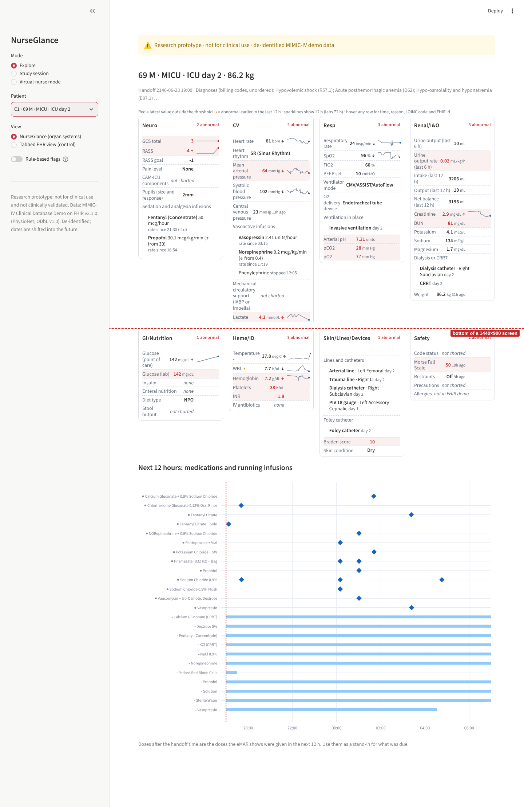
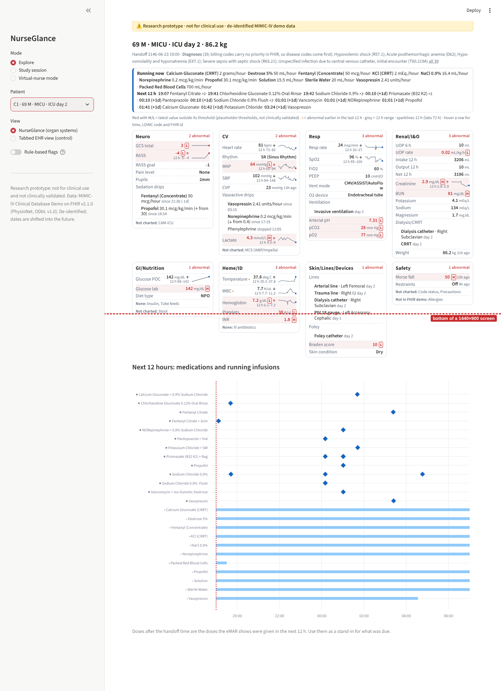
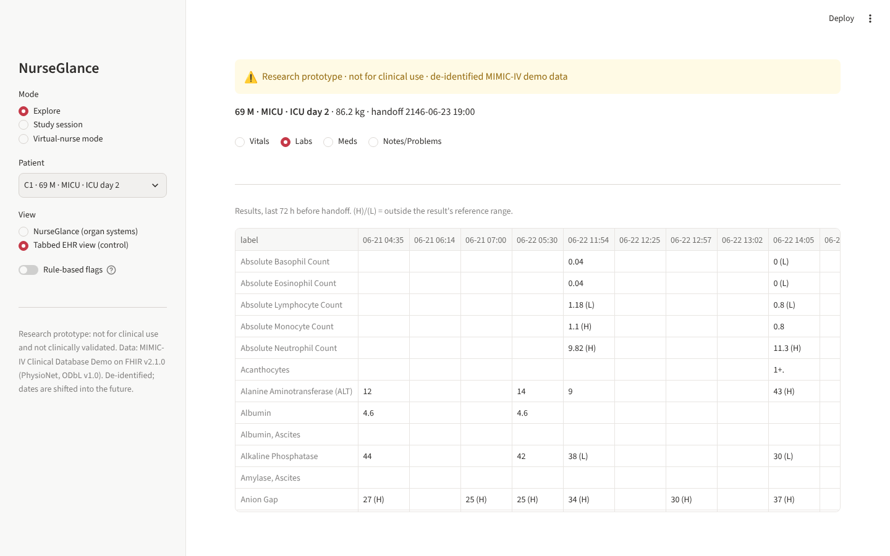
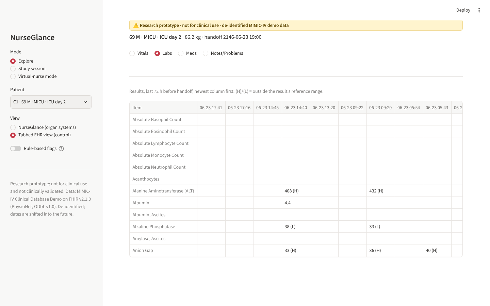
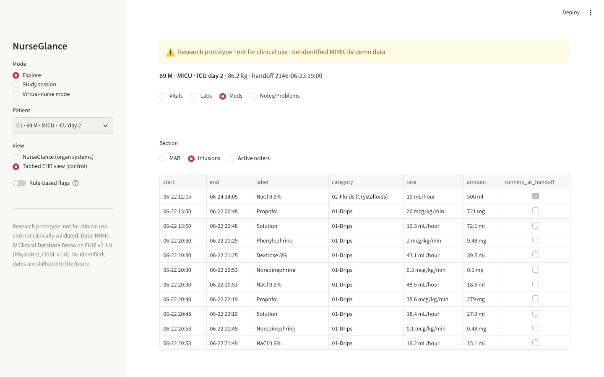
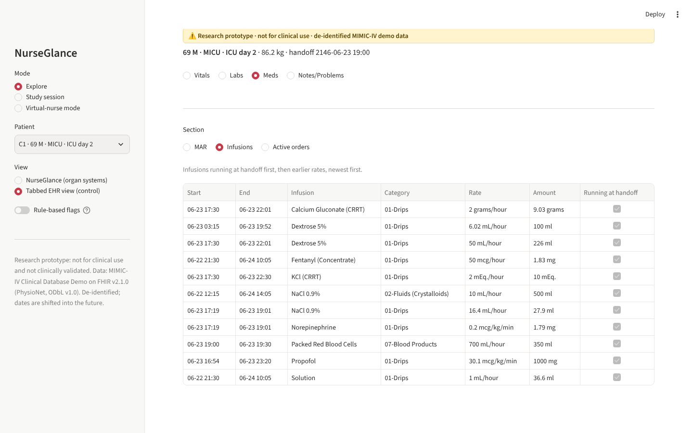

# Heuristic evaluation of both views (draft for review)

**Status: draft.** One evaluator, who also built the interface, rated these problems.
A sound heuristic evaluation uses 3 to 5 independent evaluators, because one evaluator
finds only about a third of the problems (Nielsen and Molich 1990). The author should review and
re-rate each problem, and ideally add two or more evaluators with ICU nursing or
usability experience. Their comments would be informal design feedback, not study data.

## Method

- **Heuristics:** Nielsen's 10 usability heuristics (Nielsen 1994), which Zhang and
  colleagues adapted for patient-safety reviews of clinical systems (Zhang et al. 2003).
- **Severity:** Nielsen's 0 to 4 scale: 0 not a problem, 1 cosmetic, 2 minor, 3 major
  (important to fix), 4 catastrophe (must fix before release).
- **What was rated:** version 0.2 of both views, for all four cases, on a 1440×900 screen,
  in Explore and Study modes. Evidence comes from screenshots and from the task
  analysis (`docs/task_analysis.md`), which measured the clicks, scrolls and hovers each
  study question needs.
- **Rule:** fix every problem rated 3 or 4 in version 0.3, fix cheap 1s and 2s, then
  re-rate everything and rerun the task analysis.
- **The tabbed view is the control.** For it, the question is fidelity: does it behave
  like a current EHR? A weak control would exaggerate NurseGlance's advantage, so its
  fidelity problems were fixed too.

## Findings and re-ratings

Severity is shown as version 0.2 → version 0.3.

### NurseGlance

| ID | Heuristic | Problem in version 0.2 | Severity | Change in version 0.3 |
| --- | --- | --- | --- | --- |
| N1 | Aesthetic and minimalist design; visibility | The "one screen" goal was not met on a laptop. On 1440×900 only the first rows of the top four panels showed; the page was 2.2 screens tall in study mode. Long labels wrapped to 3 to 5 lines ("Mechanical circulatory support (IABP or Impella)"), and "not charted" rows took a full line each. NurseGlance needed 0.9 scrolls per question. | 3 → 2 | Short labels on one line (full name in the tooltip), compact rows, a slimmer banner and header, and empty elements folded into one "None:" or "Not charted:" line per panel. All 8 panels now fit for the standard cases; the last rows of the complex cases' lower panels still fall below the edge. |
| N2 | Recognition rather than recall | The 12-hour range, and so the worst value of the shift, was only in a hover tooltip. Answering "lowest MAP in 12 h" needed a hover, and tooltips do not work on touch screens or from the keyboard. | 3 → 1 | The 12-hour range is printed under every trended value ("12 h 63–97"). |
| N3 | Visibility of system status | Exact dose times were only in the timeline's hover labels, at the bottom of the page; its axis is marked every 2 hours. Every timing question needed a scroll and a hover. | 3 → 1 | A "Next 12 h" line at the top lists the first dose time of each drug. |
| N4 | Match with the real world (patient safety) | Infusions outside the sedation and vasoactive panels, such as S1's heparin (a high-alert drug), appeared only as unlabeled bars in the timeline below the edge. | 3 → 1 | A "Running now" line at the top lists every infusion running at handoff with its rate. |
| N5 | Match with the real world | The header showed the first 3 billing diagnoses in arbitrary order. For S2 it showed hypercholesterolemia and hyperlipidemia but not the subarachnoid hemorrhage that brought her to the Neuro ICU. FHIR Condition carries no priority (see `docs/coverage.md`). | 3 → 2 | Shows 5 diagnoses with disease codes before status codes and external causes, links to the full list, and says the order is not a priority. A true priority is still missing from the data. |
| N6 | Error prevention | Thresholds are placeholders, but the legend did not say so, which invites over-trust in the red values. | 2 → 1 | The legend says "placeholder thresholds, not clinically validated". |
| N7 | Consistency and standards (WCAG 1.4.1, use of color) | Abnormal values were marked by red text and a faint tint only. | 2 → 1 | An H or L badge beside each abnormal value. |
| N8 | Recognition rather than recall | Provenance (charted time, LOINC code, FHIR id) is only in a hover tooltip, out of reach by keyboard or touch. | 2 → 2 | Not changed. A click-to-open detail is planned. |
| N9 | Consistency and standards | Sparklines cover 12 h for vitals but 72 h for labs, while the arrows and ranges cover 12 h for both. | 2 → 2 | Not changed; the legend states the windows. |
| N10 | Aesthetic and minimalist design | The timeline lists every eMAR product, including flushes and mouth rinse, under MIMIC's long product names, and every carrier infusion ("Solution", "Sterile Water"). The new "Running now" line repeats the carrier fluids. | 2 → 2 | Not changed. Grouping or hiding carrier fluids is a clinical decision for the author to make. |
| N11 | Aesthetic and minimalist design | Panel titles showed link icons, because Streamlit adds anchors to headings. | 1 → 0 | Titles are no longer headings. |

### Tabbed view (control): fidelity to a current EHR

| ID | Heuristic | Problem in version 0.2 | Severity | Change in version 0.3 |
| --- | --- | --- | --- | --- |
| T1 | Visibility of system status | Flowsheet and lab columns ran from oldest to newest, and the table opens at the left, so every "latest value" needed a sideways scroll. Current EHR flowsheets open at the newest results. | 3 → 0 | Newest column first, next to the labels. |
| T2 | Recognition rather than recall | GCS total, Braden and Morse scores and the shift totals sat in a "Derived" group made by the ETL, away from their parts. | 3 → 0 | Each calculated value sits in the group where its parts are charted (GCS total under Neurological). |
| T3 | Visibility of system status | C1 had 119 infusion rows in start order; the running drips were near the bottom. | 3 → 0 | Running infusions first, then earlier rates, newest first. |
| T4 | Visibility of system status | The MAR listed 24 hours of given doses before the upcoming ones. | 2 → 0 | Upcoming doses first, then given doses, newest first. |
| T5 | Match with the real world | Raw column names ("running_at_handoff", "label"). | 1 → 0 | Readable names. |
| T6 | Match with the real world | Labs are one alphabetical list (94 rows for C1), not grouped by panel (chemistry, blood count, blood gas). | 2 → 2 | Not changed: the demo's lab Observations carry only "laboratory" as a category. |
| T7 | User control and freedom | Leaving a tab resets its Meds section or flowsheet group. | 1 → 1 | Not changed. |

### Study screen

| ID | Heuristic | Problem in version 0.2 | Severity | Change in version 0.3 |
| --- | --- | --- | --- | --- |
| S1 | Recognition rather than recall | The question sat above the view. After scrolling down to find an answer, a participant had to scroll back up to type it, and the question pushed the view about 250 px down. This penalizes whichever view needs more scrolling. | 3 → 0 | The question sits in the sidebar, beside the view, and stays in sight. |
| S2 | Error prevention | The seed field took a new default on every rerun, so Streamlit dropped a seed the user typed and started a random order. A session could not be reproduced on purpose. | 3 → 0 | The default is kept for the session, so a typed seed is used. |

### What already worked

- Panels follow the organ-system order that nurses use for systems-based handoff.
- Every value can be traced to its FHIR resource, time and LOINC code.
- "None" (nothing running or in place), "not charted" (no value) and "not in FHIR demo"
  (no source) are kept apart, so a true negative is not confused with a data gap.
- Values older than 6 hours say how old they are ("17h ago").
- DNR status that comes from a billing code is labeled as such.

## Summary of the re-rating

| | Problems rated 3 or 4 in 0.2 | In 0.3 |
| --- | --- | --- |
| NurseGlance | 5 (N1 to N5) | 0 |
| Tabbed view (fidelity) | 3 (T1 to T3) | 0 |
| Study screen | 2 (S1, S2) | 0 |

Problems still rated 2: N1 (complex cases overflow a 1440×900 screen), N5 (no true
diagnosis priority), N8 (provenance by hover only), N9 (mixed trend windows), N10
(timeline clutter) and T6 (labs not grouped).

## Effect on the task analysis

From `docs/task_analysis.md` (16 questions, 1440×900, design-level estimates):

| | Version 0.2 | Version 0.3 | Version 1.1 |
| --- | --- | --- | --- |
| NurseGlance: scrolls + hovers per question | 0.9 + 0.4 | 0 + 0 | 0 + 0 |
| NurseGlance: estimated seconds per question | 5.9 | 3.2 | 3.2 |
| Tabbed view: clicks, scrolls per question | 1.5, 4.1 | 1.5, 1.9 | 1.4, 1.9 |
| Tabbed view: estimated seconds per question | 18.1 | 12.9 | 12.4 |

The tabbed view got faster in version 0.3 because its fidelity fixes removed most
sideways scrolling, and again in version 1.1 because its Summary tab answers two
current-value lookups without a click.

## Version 1.1: screen review

After version 0.3, every screen was reviewed against the AWARE trial's design and
outcomes (Khairat et al. 2025, JMIR Res Protoc), the virtual-nursing fatigue study
(Khairat et al. 2025, JMIR Hum Factors) and the ICU nurse survey (Lindroth et al. 2022).
The review was not re-rated with the heuristics above; it changed the following.

| Area | Change in version 1.1 | Finding it touches |
| --- | --- | --- |
| Control fidelity | Opens on a Summary tab (latest vital signs, infusions running at handoff, 12-hour intake and output), as a current EHR's summary screen does. Adds a patient banner (code status, allergies, isolation), a Problems tab and a Lines & drains tab; the Meds tab is now the MAR, with a Home meds section. | New. Keeps the control from being a straw man. |
| NurseGlance header | Shows the ED chief complaint as the reason for admission when the patient came through the emergency department (S1, S2), with its FHIR source; otherwise the first 3 disease diagnoses and a note that FHIR carries no priority. Chips for code status, allergies, isolation and VTE prophylaxis. | N5: fixed for S1 and S2, still 2 for C1 and C2, which have no ED encounter. |
| NurseGlance task strip | Three rows: infusions running now with their titration since 12 hours ago, care done in the last 12 hours (turns, oral, bath and eye care, labs drawn, doses given), and doses and the next turn due in the next 12 hours, in time order. | N3, N4 (kept at 1). The turn interval (every 2 hours) is a placeholder rule and says so. |
| NurseGlance layout | The 8 panels sit in four columns, two systems each, so no column leaves a gap. | N1 (still 2): standard cases fit a 1440×900 screen; for C1 (INR, Foley, Braden, skin) and C2 (IV antibiotics, Braden, skin) the last rows fall below the edge. None of the 16 answers is there. |
| Same facts in both views | Code status, allergies and isolation appear in both views, so the comparison tests layout, not data. | New. |
| Study screen | 2 untimed practice questions on a fifth stay before each view, a break screen between views, a Pause button that hides the view and stops the clock, a progress bar, and debrief notes in the log. While a session runs, the other pages are hidden. | New. Matches the protocol's procedure. |
| Virtual nurse | Shows what is already in the chart, marks checklist items the chart already covers, offers "take a break" or "snooze" at 10 minutes, and writes a review note for the bedside nurse. | New. |

Problems N8, N9, N10, T6 and T7 are unchanged.

## Version 1.2: design mockup

Version 1.2 gave both views the look of a design mockup (`docs/design/`). It was not
re-rated with the heuristics; these are measured facts that bear on the ratings above.

| Problem | What version 1.2 measured |
| --- | --- |
| N1 (fit) | In study mode, every card of every case ends above the bottom of a 1440×900 screen (lowest edge: C1 at 897 px). On the Handoff page, whose patient picker and title add height, C1 and C2 end at 976 and 954 px. On 1366×768 in study mode, one of the 16 NurseGlance paths needs a scroll. |
| N3, N4 | The 12-hour timeline is gone. Due doses and turns are in the Tasks & meds column; infusions that no card lists are in the patient card. |
| N7 (color) | The "abnormal earlier" dot now uses the warning color (5.8:1 on white). Every text color the app sets meets the WCAG AA 4.5:1 ratio. |
| N10 (clutter) | Due doses show the drug without its carrier fluid ("Vancomycin", not "Vancomycin + Iso-Osmotic Dextrose"), but the patient card still lists carrier infusions running at handoff. Still a clinical decision. |

The replay of all 32 paths on version 1.2 gave the same clicks, scrolls, hovers and screens
as version 1.1, and the app's event log matched every path (`docs/task_analysis.md`).

## Screenshots

| Version 0.2 | Version 0.3 |
| --- | --- |
|  |  |
|  |  |
|  |  |

The red dashed line marks the bottom of a 1440×900 screen. Study mode in version 0.3:
`figures/after_study_S2-Q2_glance.png` and `figures/after_study_S2-Q2_tabbed.png`.

Version 1.1 on a 1440×900 screen: NurseGlance for C1 (`figures/v1.1_glance_C1_screen.png`)
and the control's Summary tab for C1 (`figures/v1.1_tabbed_C1_summary.png`).
Version 1.2, study mode, 1440×900: NurseGlance for C1 (`figures/v1.2_glance_C1_screen.png`).

## References

- Khairat S, Morelli J, Boynton MH, Bice T, Gold JA, Carson SS. Investigating information
  visualization to combat information overload in electronic health records: protocol for
  a randomized controlled trial. JMIR Res Protoc. 2025;14:e74247.
- Khairat S, Morelli J, Liao WT, Aucoin J, Edson BS, Jones CB. Association of virtual
  nurses' workflow and cognitive fatigue during inpatient encounters: cross-sectional
  study. JMIR Hum Factors. 2025;12:e67111.
- Lindroth HL, Pinevich Y, Barwise AK, et al. Information and data visualization needs
  among direct care nurses in the intensive care unit. Appl Clin Inform.
  2022;13(5):1207-1213.
- Nielsen J, Molich R. Heuristic evaluation of user interfaces. In: Proceedings of the
  SIGCHI Conference on Human Factors in Computing Systems (CHI '90). ACM; 1990:249-256.
- Nielsen J. Enhancing the explanatory power of usability heuristics. In: Proceedings of
  the SIGCHI Conference on Human Factors in Computing Systems (CHI '94). ACM; 1994:152-158.
- Nielsen J. Severity ratings for usability problems. Nielsen Norman Group; 1995.
- Zhang J, Johnson TR, Patel VL, Paige DL, Kubose T. Using usability heuristics to
  evaluate patient safety of medical devices. J Biomed Inform. 2003;36(1-2):23-30.
  PMID 14552844.
