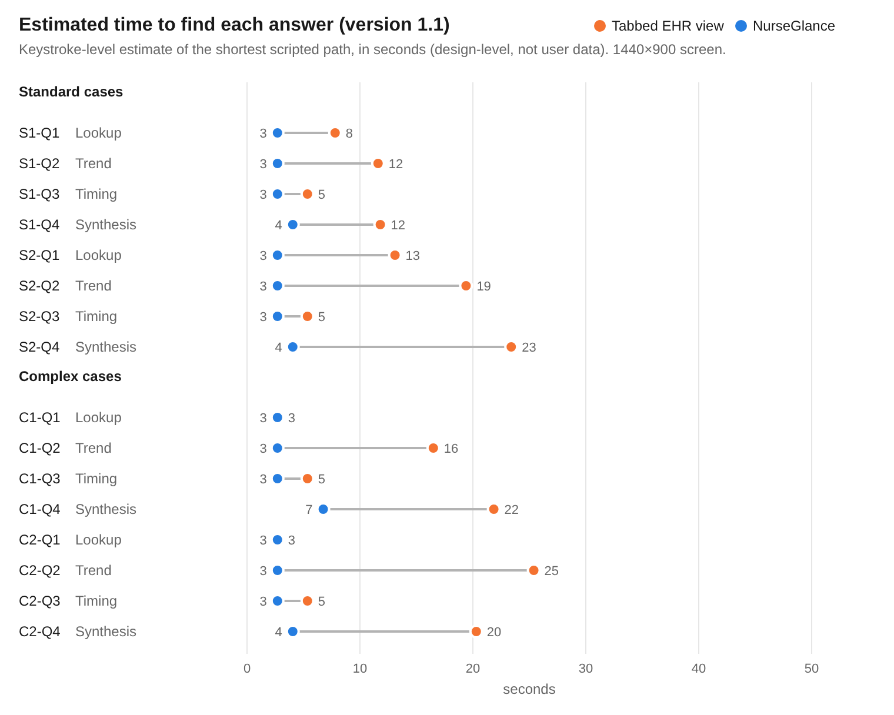

# Research question 2, part 1: how much work does each view ask for?

In version 1.1, the shortest path to an answer took an estimated **12.4 s** in the tabbed view and **3.2 s** in NurseGlance, averaged over the 16 questions (version 0.3: 12.9 s and 3.2 s; version 0.2: 18.1 s and 5.9 s). NurseGlance needed no clicks, scrolls or hovers for any question on a 1440×900 screen. These are design-level estimates of a scripted expert path, not measurements of nurses.

Produced by `analysis/replay.py` and `analysis/task_analysis.py` (this file is generated
from `analysis/task_analysis_template.md`). Data: `docs/task_replay.json` and the
per-question table `docs/task_analysis.csv` (version 1.1); the earlier versions' runs are
kept as `docs/task_replay_v0.2.json`, `docs/task_replay_v0.3.json` and their CSVs.

## What was measured

- **Tasks:** the 16 study questions, 4 per case (lookup, trend, timing, synthesis), in
  each of the two views.
- **Paths:** for each question and view, the shortest path to the data the answer key
  names: fewest clicks first, then fewest scrolls (`analysis/paths.py`). For a
  synthesis question, the path covers the values that the rubric's first concern needs
  for a score of 2.
- **Replay:** a Playwright script runs the app's own study mode with two seeds whose
  plans are complementary, so each question is answered once in each view, in study
  order. Questions about the same patient follow each other, so a path starts wherever
  the previous one left the tabbed view, which opens on its Summary tab. The two
  practice questions before each view are answered but not measured.
- **Checks:** at the end of each path, the script confirms that every value the path
  names is on screen (or in the hover text), submits the answer key, and compares its
  click and screen counts with the app's own event log. All 32 paths matched the log,
  and the app scored every lookup, trend and timing key as correct.
- **Screen:** 1440×900 pixels (a common laptop), Chromium. The study question sits in
  the sidebar, so the main area holds only the view.

## Counting rules

| Count | Rule |
| --- | --- |
| Clicks | A tab, a MAR section or a Flowsheet section change. A Flowsheet section change is 2 clicks (open the list, pick the section). |
| Scrolls | One gesture moves the page, a table or a dropdown list by up to 87.5% of its visible height (like Page Down), or 65% of a table's width (its label column stays put). Jumping to the start or end of a table (dragging its scroll bar) is one gesture. For tables, the script tries scrolling from where the table is and jumping to either end first, and keeps the shorter. |
| Hovers | Pointing at a value to read its tooltip or a timeline dose. |
| Screens | 1 plus the number of different tabs opened (the app's own definition). |

## Keystroke-Level Model

Operator times from Card, Moran and Newell (1980), as used by Kieras (2001): pointing
(P) 1.10 s, mouse button press and release (BB) 0.20 s, mental preparation (M) 1.35 s.
Answer entry is left out because it is the same in both views.

| Step | Operators |
| --- | --- |
| Start | M (decide where to look) |
| Each click | M + P + BB |
| Each scroll gesture | M + P (KLM has no scroll operator; P stands for the wheel or drag movement, M for searching what came into view) |
| Each hover | P (the reading is counted below) |
| Each value read | M (a table row, a panel row, a list item or a tooltip) |
| Each extra step | M (for example, compare two values or find the lowest in a row) |

## Results

| Version | Cases | View | Clicks | Scrolls | Hovers | Screens | Estimated seconds |
| --- | --- | --- | --- | --- | --- | --- | --- |
| 0.2 | standard | Tabbed EHR | 1.6 | 3.1 | 0.0 | 1.8 | 16.2 |
| 0.2 | standard | NurseGlance | 0.0 | 0.6 | 0.5 | 1.0 | 5.1 |
| 0.2 | complex | Tabbed EHR | 1.4 | 5.0 | 0.0 | 1.9 | 19.9 |
| 0.2 | complex | NurseGlance | 0.0 | 1.2 | 0.2 | 1.0 | 6.7 |
| 0.2 | all | Tabbed EHR | 1.5 | 4.1 | 0.0 | 1.8 | 18.1 |
| 0.2 | all | NurseGlance | 0.0 | 0.9 | 0.4 | 1.0 | 5.9 |
| 0.3 | standard | Tabbed EHR | 1.6 | 1.4 | 0.0 | 1.8 | 11.9 |
| 0.3 | standard | NurseGlance | 0.0 | 0.0 | 0.0 | 1.0 | 3.0 |
| 0.3 | complex | Tabbed EHR | 1.4 | 2.5 | 0.0 | 1.9 | 13.8 |
| 0.3 | complex | NurseGlance | 0.0 | 0.0 | 0.0 | 1.0 | 3.4 |
| 0.3 | all | Tabbed EHR | 1.5 | 1.9 | 0.0 | 1.8 | 12.9 |
| 0.3 | all | NurseGlance | 0.0 | 0.0 | 0.0 | 1.0 | 3.2 |
| 1.1 | standard | Tabbed EHR | 1.8 | 1.4 | 0.0 | 2.0 | 12.2 |
| 1.1 | standard | NurseGlance | 0.0 | 0.0 | 0.0 | 1.0 | 3.0 |
| 1.1 | complex | Tabbed EHR | 1.0 | 2.4 | 0.0 | 1.8 | 12.5 |
| 1.1 | complex | NurseGlance | 0.0 | 0.0 | 0.0 | 1.0 | 3.4 |
| 1.1 | all | Tabbed EHR | 1.4 | 1.9 | 0.0 | 1.9 | 12.4 |
| 1.1 | all | NurseGlance | 0.0 | 0.0 | 0.0 | 1.0 | 3.2 |

The same chart for earlier versions is `figures/task_time_v0.3.png` and
`figures/task_time_v0.2.png`. All the charts share one scale. On a 1920×1080 screen (`docs/sensitivity/task_replay_1920x1080.json`), version 1.1 gave 11.8 s for the tabbed view and 3.2 s for NurseGlance. NurseGlance needed no clicks, scrolls or hovers for any question.

### Per question, version 1.1

Scroll counts include page scrolls; the path column lists clicks and table scrolls.

| Question | Kind | Tabbed: clicks, scrolls, screens | Tabbed path | NurseGlance: scrolls, hovers | Seconds (tabbed / NurseGlance) |
| --- | --- | --- | --- | --- | --- |
| S1-Q1 | Lookup | 1, 1, 2 | Labs tab; find Potassium row (1 scroll) | 0, 0 | 7.8 / 2.7 |
| S1-Q2 | Trend | 1, 2, 2 | Flowsheet tab; scan 10-31 07:00 to 10-31 19:00 (2 scrolls) | 0, 0 | 11.6 / 2.7 |
| S1-Q3 | Timing | 1, 0, 2 | MAR tab | 0, 0 | 5.3 / 2.7 |
| S1-Q4 | Synthesis | 2, 1, 3 | Summary tab; Labs tab; find Hemoglobin row (1 scroll) | 0, 0 | 11.8 / 4.0 |
| S2-Q1 | Lookup | 3, 1, 2 | Flowsheet tab; Neurological Flowsheet section | 0, 0 | 13.1 / 2.7 |
| S2-Q2 | Trend | 2, 3, 1 | Routine Vital Signs Flowsheet section; scan 01-15 19:00 to 01-16 07:00 (1 scroll) | 0, 0 | 19.4 / 2.7 |
| S2-Q3 | Timing | 1, 0, 2 | MAR tab | 0, 0 | 5.3 / 2.7 |
| S2-Q4 | Synthesis | 3, 3, 2 | Flowsheet tab; scan 01-15 19:00 to 01-16 07:00 (1 scroll); Neurological Flowsheet section; scroll to 01-16 06:00 (1 scroll) | 0, 0 | 23.4 / 4.0 |
| C1-Q1 | Lookup | 0, 0, 1 | read on the first screen | 0, 0 | 2.7 / 2.7 |
| C1-Q2 | Trend | 1, 4, 2 | Labs tab; find Lactate row (4 scrolls) | 0, 0 | 16.5 / 2.7 |
| C1-Q3 | Timing | 1, 0, 2 | MAR tab | 0, 0 | 5.3 / 2.7 |
| C1-Q4 | Synthesis | 2, 4, 3 | Summary tab; Labs tab; find Lactate row (4 scrolls) | 0, 0 | 21.9 / 6.8 |
| C2-Q1 | Lookup | 0, 0, 1 | read on the first screen | 0, 0 | 2.7 / 2.7 |
| C2-Q2 | Trend | 2, 6, 2 | MAR tab; Infusions section; find Norepinephrine 03-26 06:30 row (5 scrolls); find Norepinephrine row (1 scroll) | 0, 0 | 25.4 / 2.7 |
| C2-Q3 | Timing | 1, 0, 1 | Doses section | 0, 0 | 5.3 / 2.7 |
| C2-Q4 | Synthesis | 1, 5, 2 | Labs tab; find Hemoglobin row (3 scrolls); find Platelet Count row (2 scrolls) | 0, 0 | 20.3 / 4.0 |

## What changed in version 1.1

Version 1.1 follows a review of the screens against the AWARE trial's design and the
virtual-nursing fatigue study (both from Dr. Saif Khairat's group) and against the nurse
survey that motivates the project:

- **The tabbed view** gained a Summary tab, which it opens on: latest vital signs,
  infusions running at handoff and 12-hour intake and output, as the summary screen of a
  current EHR shows them. It also gained a patient banner (code status, allergies,
  isolation) and separate Problems and Lines & drains tabs, and the Meds tab became the
  MAR with a Home meds section. The Summary tab answers two current-value lookups with no
  click, so the control is faster than in version 0.3. This keeps the comparison fair.
- **NurseGlance** gained a patient header with the reason for admission and safety chips
  (code status, allergies, isolation, VTE prophylaxis), and its medication strip became a
  task strip: infusions running now with their titration, care done in the last 12 hours,
  and doses and turns due in the next 12 hours. The eight panels sit in four columns.
- **The study screen** gained two practice questions before each view and a break between
  the views, as in the protocol. Neither is timed.

## What changed between version 0.2 and 0.3

Both views changed, for reasons recorded in `docs/heuristic_evaluation.md`:

- **NurseGlance** was redesigned so a nurse can answer without scrolling or hovering:
  shorter labels on one line, the 12-hour range printed under each trended value, empty
  elements folded into one line per panel, and a medication strip at the top listing
  every infusion running now and the next dose of each drug with its time.
- **The tabbed view** was made closer to a current EHR, so the comparison is not against
  a straw man: newest columns first, calculated scores (GCS total, Braden, Morse) in the
  flowsheet group where their parts are charted, running infusions listed first, and
  upcoming doses first in the MAR. This made the tabbed view faster too.
- **The study screen** moved the question into the sidebar, which removed most page
  scrolling in both views.

## Limits of these numbers

- They describe an expert who knows where everything is and makes no errors. They are
  design-level estimates, not data from nurses, and they are not evidence that either
  view is safer or better for patients.
- KLM gives every search the same 1.35 s. Finding one value among about 58 on a dense
  screen like NurseGlance likely takes longer than that, so the model probably favors
  NurseGlance. Only the user study can measure search time.
- The no-scroll result for NurseGlance depends on the screen and the questions. All
  eight panels fit on a 1920×1080 screen for all four cases. On 1440×900 they fit for
  the standard cases, but the last rows of the complex cases' lower panels fall below
  the edge (none of the 16 answers is there). On 1366×768 the standard cases still fit,
  but the complex cases need a scroll for their lower panels, where C2's hemoglobin and
  platelets sit.
- Treating a scroll gesture as one pointing operation is an assumption.
- The tabbed view is the author's own control, not a commercial EHR. A real EHR may offer
  shortcuts (search, saved views) or cost more (log-ins, slower screens, more tabs).
- The 16 questions and their answer keys were written by the author for these 4 cases
  and still need clinical review.

## References

- Card SK, Moran TP, Newell A. The keystroke-level model for user performance time with
  interactive systems. Commun ACM. 1980;23(7):396-410.
- Kieras D. Using the keystroke-level model to estimate execution times. University of
  Michigan; 2001.
