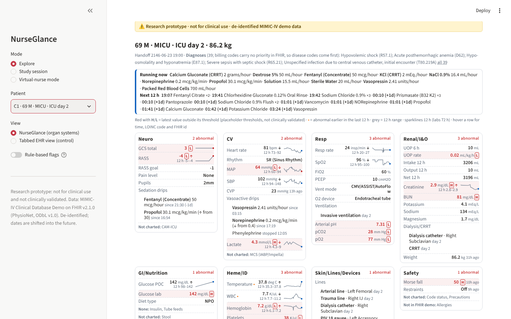
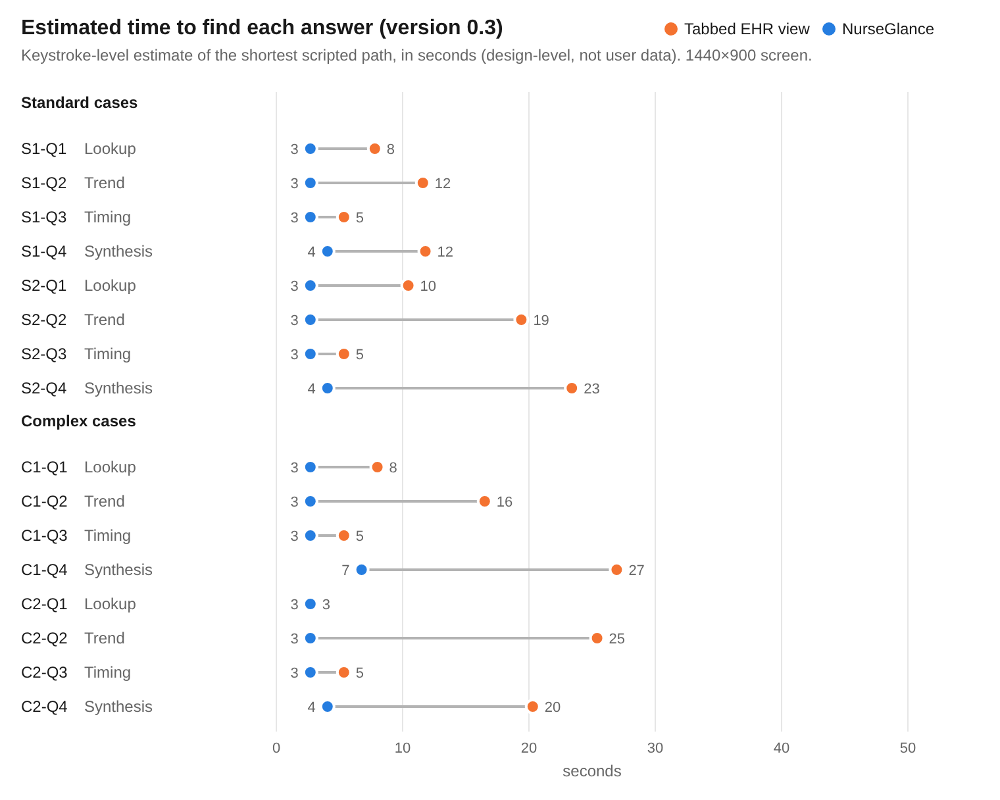

# NurseGlance: a nurse-centered, FHIR-based ICU handoff dashboard

**Technical report, version 0.3 · Ibrahim Baabdallah · November 2026**

Research prototype, not for clinical use. No nurse has taken part in a study. Every click
and time result below is a design-level estimate from scripted runs, not a measurement of
nurses. Code: github.com/ibrahimbaabdullah-jpg/nurseglance (MIT license). Data: MIMIC-IV
Clinical Database Demo on FHIR v2.1.0 (Bennett et al. 2025; PhysioNet, ODbL).

## Summary

ICU nurses review the chart at every handoff, and in a typical EHR the values they need
are spread across tabs. NurseGlance shows one patient on one screen, by organ system, with
a list of running infusions and upcoming doses at the top. It reads standard HL7 FHIR R4
resources and shows the same patients in a conventional tabbed view, which serves as the
control. On four ICU patients from the open MIMIC-IV demo, 57 of 58 nurse handoff data
elements (98%) could be mapped to FHIR. A scripted replay of the shortest path to each of
16 handoff answers, scored with the keystroke-level model, estimated 3.2 s per question
for NurseGlance and 12.9 s for the tabbed view, with no clicks, scrolls or hovers in
NurseGlance on a 1440×900 screen. A heuristic evaluation found 10 major problems across both
views and the study screen; all were fixed and re-rated. A crossover study with ICU and
virtual nurses is proposed to test whether these estimates hold for real users.

## 1. Introduction

Information overload in the EHR is linked to cognitive fatigue and lower efficiency in intensive
care (Khairat et al. 2020). Among 107 ICU direct-care nurses surveyed at several centers, 64% said current EHR
visualization was insufficient at handoff, 53% wanted screens organized by organ system,
and 61% wanted them organized by tasks or schedule (Lindroth et al. 2022). Interfaces built
around ICU clinicians' information needs have reduced task time, workload and errors for
physicians in a randomized crossover study (Ahmed et al. 2011), and the multicenter AWARE
trial is now testing a visualization dashboard against institutional EHRs with 120 ICU
providers (Khairat et al. 2025, JMIR Res Protoc). Those studies focus on physicians and
advanced practice providers. Nurses' handoff needs differ: drips and their titration,
lines and devices, intake and output, the medication schedule, and safety risks. Virtual
nurses, who review charts remotely at admission and discharge, show cognitive fatigue
within about 10 to 12 minutes of an encounter (Khairat et al. 2025, JMIR Hum Factors).

This project asks three questions:

1. Which data elements do ICU nurses need at handoff, and can standard FHIR resources
   supply them?
2. Compared with a tabbed EHR-style view of the same data, does an organ-system view
   reduce the clicks and time needed to answer standard handoff questions? This is
   measured here with scripted runs and proposed as a user study.
3. Which usability problems remain after a structured heuristic evaluation?

## 2. Methods

**Data and cases.** The MIMIC-IV Clinical Database Demo on FHIR v2.1.0 holds 100
de-identified patients from one Boston academic center, with dates shifted into the future.
Four ICU stays were chosen to contrast standard and complex care, as in AWARE: S1 (40 F,
cardiovascular ICU, iliac vein thrombosis on a heparin infusion), S2 (63 F, neuro ICU,
subarachnoid hemorrhage), C1 (69 M, medical ICU, cirrhosis and shock; ventilated, two
vasopressors, CRRT) and C2 (87 M, gastrointestinal bleeding; ventilated, norepinephrine
being weaned). Each case has a handoff time at 07:00 or 19:00. The CSV release of the same
demo (v2.2) was used only to check the FHIR data.

**Data elements and pipeline.** A starter list of 58 handoff data elements in 8 organ-system
groups (neuro, cardiovascular, respiratory, renal and intake/output, GI and nutrition,
hematology and infection, skin, lines and devices, and safety) was drawn from the survey
above and nursing handoff practice. A Python pipeline reads the FHIR NDJSON files
(Patient, Encounter, Observation, MedicationAdministration, MedicationRequest, Procedure,
Condition and others) and writes one JSON file per case: values in a 24-hour window (72
hours for labs), running infusions and devices at handoff, and medications given in the 12
hours after handoff. Fifty displayed items were mapped to LOINC and each code checked
against the NLM. The project has 64 automated tests, including one that compares the FHIR
data with the CSV tables.

**Two views.** The control has four tabs (Vitals, Labs, Meds, Notes/Problems), a
flowsheet with groups, and newest-first tables, like a current EHR. NurseGlance (Figure 1)
shows a header with diagnoses, a medication strip, 8 organ-system panels with the latest
value, a trend arrow, the 12-hour range and an H or L badge when abnormal, and a 12-hour timeline of
doses and infusions. Empty elements are folded into one line per panel, and "none", "not
charted" and "not in FHIR demo" are kept apart so a true negative is not mistaken for a
data gap. Eight rule-based flags, each showing its rule and evidence, are available in
explore mode and turned off in study mode.

**Study mode and questions.** Sixteen draft questions, 4 per case, cover a lookup, a trend,
a timing and a synthesis question ("What is your top safety concern for the next 12 hours,
and what data support it?", scored 0 to 2 with a rubric). Study mode runs a full crossover
session: a seeded plan sets the view order and which cases go with each view, every click
and screen is logged with a timestamp, the SUS and raw NASA-TLX follow each view, and the
session exports CSV files.

**Task analysis.** For each question and view, the shortest path to the data the answer
key names was written as steps (fewest clicks, then fewest scrolls). A Playwright script
ran each path through the app's own study mode at 1440×900, checked that every needed
value was on screen, submitted the key, and compared its counts with the app's event log.
Times were estimated with the keystroke-level model (Card et al. 1980; Kieras 2001):
mental preparation 1.35 s, pointing 1.10 s, button press 0.20 s.

**Heuristic evaluation.** The author rated both views and the study screen against
Nielsen's 10 heuristics, with severity from 0 (not a problem) to 4 (catastrophe) (Nielsen
1994; Zhang et al. 2003). Problems rated 3 or 4 were fixed in version 0.3, and the task
analysis was run again on both versions.

## 3. Results

**Research question 1: FHIR coverage.** 57 of 58 elements (98%) have a FHIR source; only
allergies do not, because MIMIC-IV has no allergy data. In the handoff windows, 66% of
elements had a value for each standard case and 84% for each complex case; most empty
cells are true negatives, such as no PEEP for a patient who is not ventilated. For every
element's items, the FHIR files hold the same number of records as the CSV tables, and
sampled values match. The gaps lie elsewhere:

- **Coded text lost in conversion.** Ventilator mode, pain level and CAM-ICU arrive as
  MIMIC's numeric codes without their text (ventilator mode "CMV/ASSIST/AutoFlow" arrives
  as 49). A 40-pair lookup table rebuilt from the CSV restores them.
- **Diagnosis priority lost.** FHIR Condition carries no billing sequence, so diagnoses
  arrive unordered. For one case, the first three listed included two lipid disorders but
  not the subarachnoid hemorrhage that brought the patient to the ICU.
- **No standard terminology.** Chart and lab items use MIMIC's own code systems; LOINC
  appears only on emergency department vital signs. Of the older lab LOINC codes, 2 were
  deprecated and 1 did not fit its unit.
- **No schedule.** MIMIC records doses given, not doses due, so doses given in the next 12
  hours stand in for the schedule, and the screen says so.

**Research question 2: work per question (design-level estimates).** Every one of the 32
replayed paths matched the app's own log. Table 1 and Figure 2 show the results.

| Version | View | Clicks | Scrolls | Hovers | Estimated seconds |
| --- | --- | --- | --- | --- | --- |
| 0.2 (before) | Tabbed EHR | 1.5 | 4.1 | 0.0 | 18.1 |
| 0.2 (before) | NurseGlance | 0.0 | 0.9 | 0.4 | 5.9 |
| 0.3 (after) | Tabbed EHR | 1.5 | 1.9 | 0.0 | 12.9 |
| 0.3 (after) | NurseGlance | 0.0 | 0.0 | 0.0 | 3.2 |

*Table 1. Mean per question over 16 questions, 1440×900 screen.*

In version 0.3, NurseGlance was estimated faster on 15 of 16 questions and tied on one
lookup. The gap was largest for trend questions (2.7 s against 18.2 s), where the tabbed
view needs scrolling across flowsheet columns, and for synthesis questions (4.7 s against
20.6 s), which need values from several tabs. Complex cases took longer than standard
cases in the tabbed view (13.8 s against 11.9 s) but barely changed NurseGlance (3.4 s
against 3.0 s). On a 1920×1080 screen the estimates were 12.2 s and 3.2 s.

**Research question 3: heuristic evaluation.** Version 0.2 had 10 problems rated 3
(major). Five were in NurseGlance: the page did not fit one laptop screen; the 12-hour
worst value was only in a hover tooltip; dose times were only in the timeline at the
bottom; infusions outside the drip panels, including a heparin infusion, were easy to
miss; and the header showed arbitrary diagnoses. Three were fidelity problems in the
control (oldest columns first, calculated scores in a separate group, running drips near
the bottom of a 119-row list), fixed so that NurseGlance is not compared against a straw man.
Two were in the study screen, including a question box that cost scrolling in whichever
view needed more. After the redesign, none is rated above 2. Six problems remain at 2,
among them provenance shown only on hover, mixed trend windows, and timeline clutter from
carrier fluids, which needs a clinical decision. The tabbed view's estimate also fell, from
18.1 s to 12.9 s, because of its fidelity fixes.

## 4. Proposed user study

A randomized, counterbalanced crossover study with 40 nurses (20 bedside ICU, 20 virtual),
modeled on AWARE, is written up in `docs/protocol.md`. Each nurse answers 8 questions in
each view, on different patients, then completes the SUS and NASA-TLX. The primary outcome
is time per question, analyzed with a mixed-effects model of log time with crossed random
effects for nurse and question. Accuracy, synthesis scores, clicks, SUS and NASA-TLX are
secondary, and eye tracking is an optional lab-only measure. Thirty-four nurses give 80%
power for a moderate within-nurse effect (dz = 0.5); 40 allow for dropouts. The
study needs IRB approval and a faculty principal investigator, and has not started.

## 5. Limitations

- The click and time results describe a scripted expert who knows where everything is.
  The keystroke-level model gives every search the same 1.35 s, and finding one value
  among about 58 on a dense screen likely takes longer, so the model probably favors
  NurseGlance. Only a user study can measure search time and accuracy.
- The author built both views, wrote the questions and rated the problems. The
  questions, answer keys, thresholds and severity ratings all need review by ICU nurses,
  and a sound heuristic evaluation uses 3 to 5 evaluators.
- The control is a research build, not a commercial EHR, which may offer search and saved
  views or may cost more clicks.
- Four patients from one center's demo data, without nursing notes or a medication
  schedule, cannot represent ICU care in general. On a 1366×768 screen, NurseGlance needs
  scrolling for every case.

## 6. Equity and responsible use

The dashboard makes no predictions and uses no machine learning. Its flags are fixed rules
that show their values, times and FHIR sources, and its thresholds are marked as
placeholders that are not clinically validated. Abnormal values carry an H or L badge, so
meaning does not rest on color alone. The demo comes from one academic center in Boston,
and a design that works there may not fit community, rural or virtual-care settings with
different staffing and EHRs; the proposed study includes virtual nurses for this reason.
An optional LLM-drafted handoff summary is planned only after the user study, and would cite
the source of every statement, never act on its own, and be checked for omissions and
invented values before anyone used it. Code, data pipeline, questions and analysis are
open so that others can check and repeat the work. Parts of the code and documents were
written with an AI coding assistant, as the commit history records.

## 7. Conclusion

Standard FHIR resources can supply nearly all of what ICU nurses look for at handoff, but
conversion lost coded text and diagnosis priority, and the data carry no standard
terminology for chart items. On scripted paths, an organ-system view removed the clicks and
scrolls a tabbed view needs and cut the estimated time per question to about a quarter.
Whether nurses are faster, as accurate and less loaded with the view is a question for the
proposed study.

## References

- Ahmed A, Chandra S, Herasevich V, Gajic O, Pickering BW. The effect of two different
  electronic health record user interfaces on intensive care provider task load, errors of
  cognition, and performance. Crit Care Med. 2011;39(7):1626-1634.
  doi:10.1097/CCM.0b013e31821858a0
- Card SK, Moran TP, Newell A. The keystroke-level model for user performance time with
  interactive systems. Commun ACM. 1980;23(7):396-410.
- Bennett A, Ulrich H, Wiedekopf J, Szul P, Grimes J, Johnson A. MIMIC-IV Clinical
  Database Demo on FHIR (version 2.1.0). PhysioNet; 2025.
- Bennett AM, Ulrich H, van Damme P, Wiedekopf J, Johnson AE. MIMIC-IV on FHIR: converting
  a decade of in-patient data into an exchangeable, interoperable format. J Am Med Inform
  Assoc. 2023;30(4):718-725. doi:10.1093/jamia/ocad002
- Khairat S, Coleman C, Ottmar P, Jayachander DI, Bice T, Carson SS. Association of
  electronic health record use with physician fatigue and efficiency. JAMA Netw Open.
  2020;3(6):e207385. doi:10.1001/jamanetworkopen.2020.7385
- Khairat S, Morelli J, Boynton MH, Bice T, Gold JA, Carson SS. Investigating information
  visualization to combat information overload in electronic health records: protocol for
  a randomized controlled trial. JMIR Res Protoc. 2025;14:e74247. doi:10.2196/74247
- Khairat S, Morelli J, Liao WT, Aucoin J, Edson BS, Jones CB. Association of virtual
  nurses' workflow and cognitive fatigue during inpatient encounters: cross-sectional
  study. JMIR Hum Factors. 2025;12:e67111. doi:10.2196/67111
- Kieras D. Using the keystroke-level model to estimate execution times. University of
  Michigan; 2001.
- Lindroth HL, Pinevich Y, Barwise AK, et al. Information and data visualization needs
  among direct care nurses in the intensive care unit. Appl Clin Inform.
  2022;13(5):1207-1213. doi:10.1055/s-0042-1758735
- Nielsen J. Enhancing the explanatory power of usability heuristics. In: Proceedings of
  the SIGCHI Conference on Human Factors in Computing Systems (CHI '94). ACM; 1994:152-158.
- Zhang J, Johnson TR, Patel VL, Paige DL, Kubose T. Using usability heuristics to
  evaluate patient safety of medical devices. J Biomed Inform. 2003;36(1-2):23-30.
